  

  <a href="https://github.com/ahm-sh/the-brief"><code>the-brief</code></a>&nbsp;&nbsp;·&nbsp;&nbsp;<a href="https://github.com/ahm-sh/demurrage-guard"><code>demurrage-guard</code></a>&nbsp;&nbsp;·&nbsp;&nbsp;<a href="https://github.com/ahm-sh/floodcut"><code>floodcut</code></a>&nbsp;&nbsp;·&nbsp;&nbsp;<a href="https://github.com/ahm-sh/leadlock"><code>leadlock</code></a>

<a href="https://www.linkedin.com/in/ahm-sh">linkedin</a>&nbsp;&nbsp;·&nbsp;&nbsp;<a href="mailto:whnnschl@gmail.com">mail</a>

